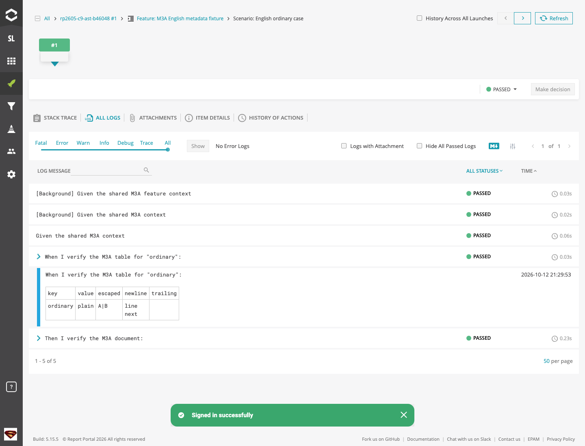

# reportportal-cucumber-ruby

Report Ruby Cucumber tests to ReportPortal, with readable Feature/Scenario/Step
structure, API request/response diagnostics, and screenshots owned by your tests.
Use the same `AppLog` calls for the terminal, native Cucumber HTML/messages, and
ReportPortal.

## Release Line Compatibility

**SDK 1.3.3** selectively backports 2.0.2 readability and example-redaction
improvements onto released 1.3.2. Download the matching Gem and checksums from
the [v1.3.3 GitHub release](https://github.com/NickYin0125/CucumberReportportal/releases/tag/v1.3.3).
RubyGems registry publication is not performed by this release process.

| SDK line | Ruby | Cucumber | Release source |
| --- | --- | --- | --- |
| 1.x / **1.3.3** | `>= 3.1` | `>= 9, < 11` | `v1.3.3` / `maintenance/1.x` |
| 2.x / **2.0.2** | `>= 3.3` | `>= 12.0.1`, `~> 12.0` | `v2.0.2` / `codex/cucumber-12` |

Cucumber 11 remains unsupported. Existing published archives and their dated
evidence are unchanged. Helm **1.3.1** / ReportPortal **26.0.7** stay independently
versioned; this SDK update requires no infrastructure upgrade.
The 1.x dependency contract and native hook topology are unchanged. Cucumber 9
requires separate DocString and DataTable steps; see the
[presentation notes](docs/advanced-reporting.md#presentation).

**New here?** Follow the five steps below. The
[complete getting-started guide](docs/getting-started.md) runs one Scenario without
a browser or a ReportPortal server before connecting your real project.

| What you need | Requirement |
| --- | --- |
| Ruby | `>= 3.1` |
| Cucumber | `>= 9, < 11` |
| Package | `reportportal-cucumber-ruby` **1.3.3**, matching release archive |
| ReportPortal | Your endpoint, project, and API key when enabling remote reporting |
| Browser tooling | Optional; belongs to your UI test project |

The SDK records tests and evidence. Your framework makes HTTP requests, performs
assertions, and owns browser/screenshot/video lifecycles. Logging an ERROR does
not fail a Scenario.

## 1. Install the gem

Obtain `reportportal-cucumber-ruby-1.3.3.gem` from the linked GitHub release,
verify its SHA-256 against `SHA256SUMS`, or use the
[isolated source-packaging workflow](examples/current_sdk/README.md#source-and-packaging-verification).
The local candidate workflow is optional; no registry publication is assumed.

From **your automation project root**, using the verified archive's absolute path:

```sh
export SDK_GEM_ARCHIVE=/absolute/path/to/reportportal-cucumber-ruby-1.3.3.gem
mkdir -p vendor/cache
cp "$SDK_GEM_ARCHIVE" vendor/cache/reportportal-cucumber-ruby-1.3.3.gem
gem install ./vendor/cache/reportportal-cucumber-ruby-1.3.3.gem --no-document
```

Add these entries to that project's `Gemfile`, then run `bundle install` from the
same directory:

```ruby
source "https://rubygems.org"
gem "cucumber", ">= 9", "< 11"
gem "reportportal-cucumber-ruby", "= 1.3.3"
```

Verify, still from **your project root**:

```sh
bundle exec ruby -e 'require "reportportal_cucumber"; puts ReportportalCucumber::VERSION'
```

Expected output: `1.3.3`. Installation may download dependencies; offline setup
requires all of them to be cached. See [installation details](docs/getting-started.md#1-install-the-gem).

## Presentation Opt-ins

Ledger's plain cards are the default. Set `RP_PRESENTATION=rich` only for RP log
accents and folded evidence; the default is `plain`, and an invalid value warns
once and uses plain. Native Cucumber HTML/messages, terminal output, user AppLog
text, names and descriptions do not acquire rich markup.

Structured AppLog HTTP and assertion logs retain their existing native Cucumber
and terminal bodies; only the RP subscriber selects the new plain or rich cards.
In 1.3.3, ERROR/FATAL cards stay plain: no new Ledger decoration is added;
existing MP4 `<video>` markup and caller-supplied HTML remain unchanged. This is
not an HTML-stripping policy. HTTP cards show responses first and retain
repeated headers; assertions label whitespace-sensitive strings and top-level key
deltas. Existing automatic HTTP/evidence redaction is strengthened, not extended
to all logging. Decision 19 preserves each native 1.x failure's original v1.3.1
message and every backtrace frame; `FailureRedactor` is not activated and raw
AppLog text/JSON is not globally redacted. Producers must keep secrets out.
Automatic URL/evidence inputs exceeding the bounded decoding budget are
intentionally withheld, not decoded without limit. This 1.x hardening is not
byte-identical to released 2.0.2 and does not repair that released 2.x tag.

`RP_RUN_CONTEXT=true` separately enables allowlisted Launch metadata; it defaults
to `false` and never overwrites explicit attributes or a non-empty description.
The 1.x line never generates a `workers` attribute.
Generated descriptions focus on available branch/commit/build context rather
than repeating runtime attributes; explicit descriptions still win.
See [configuration](docs/configuration.md#presentation-and-run-context) and
[Presentation](docs/advanced-reporting.md#presentation) for boundaries and examples.

## 2. Run one minimal Scenario

[Copy the three files in the quick start](docs/getting-started.md#2-run-one-scenario-locally):
a Feature, `features/support/env.rb`, and a step-definition file. They perform
simple arithmetic and publish one structured diagnostic.

From **the quick-start project root**, after creating those files:

```sh
mkdir -p artifacts
RP_ENABLED=false bundle exec cucumber --no-profile --publish-quiet \
  --format progress \
  --format html --out artifacts/cucumber.html \
  --format message --out artifacts/messages.ndjson \
  --format ReportPortal::Cucumber::Formatter --out artifacts/reportportal.out
```

Expected: **1 Scenario / 2 steps passed**, exit `0`, and a `Sum result` diagnostic
inside the Then step in native HTML/messages. No Node, browser, or RP service is
needed. `reportportal.out` is a separate formatter destination and may be absent;
it is not an RP report or delivery receipt.

## 3. Connect an existing Cucumber project

Add to **your project's `features/support/env.rb`**:

```ruby
require "reportportal_cucumber"
World(ReportportalCucumber::Cucumber::World)

Around do |_scenario, run|
  AppLog.with_logger(Automation::CucumberLogger.new(world: self)) { run.call }
end
```

Bind once per Scenario; use `AppLog` from your steps, clients, and page objects.
Inject `RP_ENDPOINT`, `RP_PROJECT`, and `RP_API_KEY` through your normal secret
management, then run the same formatter command with `RP_ENABLED=true`.

Expected in RP: **Launch → Feature → Scenario → Step/Hook → logs and attachments**.
Each Scenario/Examples row counts as one test; its Steps and Hooks carry evidence.
The wire Scenario type is `STEP` with `hasStats=true`, rather than `TEST`.

See the [file-by-file integration recipe](docs/getting-started.md#3-connect-reportportal-and-integrate-an-existing-project)
for configuration, Cucumber profiles, and the first-report checklist.

## 4. Add API and UI evidence as needed

Start with [API, UI, and logger best practices](docs/best-practices.md). For a
runnable HTTP + Chromium project, use the
[current SDK example](examples/current_sdk/README.md) after the minimal Scenario.

| Need | Recommended call | Where it appears |
| --- | --- | --- |
| Local debugging | `AppLog.debug("message")` | Terminal |
| Business checkpoint / small JSON | `AppLog.info("message", report: true, json: payload)` | Terminal summary, native reports, RP |
| Observed HTTP exchange | `AppLog.http(...)` | All three tracks by default; performs no request |
| Expected/actual diagnostic | `AppLog.assertion(...)` | All three tracks by default; performs no assertion |
| Screenshot in native reports and RP | `AppLog.error("failure", report: true, file: path)` | All three tracks |
| RP-only artifact or manual group | `rp_attach(...)` / `rp_step("name") { ... }` | RP |
| Explicit RP failure ownership | `rp_capture_target` + `rp_evidence(...)` | The captured, still-open Step/Hook |

The report tracks require a bound World. Ordinary level methods are
terminal-only unless `report: true` (or legacy `attach: true`) is supplied.
Use one route per artifact to avoid submitting it twice. Publish Step evidence
before that Step closes; an After-hook screenshot belongs to the After Hook.
Keep file-backed evidence until reporting finalization settles.
The current example uses unique PNG names and one RP submission per screenshot.
R02 remains unfixed: hiding passed logs can hide evidence owned by a passed
After Hook. The consolidated PNG route does not also attach that PNG to native
HTML; unique filenames are not a native HTML deduplication fix.

Example of Step logs and a Gherkin table rendered in ReportPortal:



This existing screenshot comes from the [2026-10-12 compatibility run](https://github.com/NickYin0125/CucumberReportportal/blob/main/docs/reviews/2026-10-12-reportportal-26.0.5-compatibility.md)
on ReportPortal 26.0.5; it illustrates the layout, not a new validation of your
server or the quick-start Scenario.

Terminal summaries include local date/time with milliseconds and aligned levels;
TTY colors are preserved, with no `[APPLOG]` prefix:

```text
2026-10-31 14:32:08.125  INFO   Order submitted
2026-10-31 14:32:09.438  WARN   Retrying request
```

Timestamps are terminal-only; native Cucumber and RP messages stay clean.
For source-checkout previews and the nine parameter combinations, see
[the logger examples](docs/best-practices.md#preview-terminal-and-report-routing).

## 5. Configure CI

[CI guide](docs/ci.md): pin dependencies, preserve the Cucumber exit status,
retain native evidence on failure, and decide whether reporting completeness is
required. Start with **one Launch per job**. For a shared parallel Launch, CI
creates it, injects its `RP_LAUNCH_UUID` into every worker, waits for every worker's
outcome and receipt, and completes it. Workers do not start or finish that Launch.

## Choose the next guide

| Topic | Guide |
| --- | --- |
| Complete minimal project, existing-project integration, first-report troubleshooting | [Getting started](docs/getting-started.md) |
| HTTP clients, Playwright, screenshots, logger levels/routing, safe assertions | [Best practices](docs/best-practices.md) |
| Job setup, artifacts, reporting gates, shared Launch ownership | [CI](docs/ci.md) |
| YAML keys, environment variables, defaults, units, profiles | [Configuration reference](docs/configuration.md) |
| Receipts, bounded queues, durable spool/replay, identities, attributes, links, video | [Advanced reporting](docs/advanced-reporting.md) |
| Current examples versus source QA and historical fixtures | [Examples index](examples/README.md) |
| Deploying the separate ReportPortal stack | [Helm operator guide](helm/reportportal-rich-experience/README.md) / [Compose guide](deploy/compose/README.md) |
| Release changes | [Changelog](CHANGELOG.md) |
| Design contracts and dated verification | [Historical evidence index](docs/design/README.md) |

## ReportPortal deployment from source

The companion Chart **1.3.1** pins ReportPortal **26.0.7** and official chart
**26.10.26**, requiring **Kubernetes >=1.35**. The unchanged Chart **1.3.1** is
available from the [v1.3.1 Release](https://github.com/NickYin0125/CucumberReportportal/releases/tag/v1.3.1),
or build the chart from this checkout. The root `docker-compose.yml` provides an isolated
local alternative with the same read-only video policy and retention.
See the deployment guides above for credentials, storage, migration constraints
and the archived MinIO image caveat; this is not production HA certification.
The [26.0.7 compatibility record](https://github.com/NickYin0125/CucumberReportportal/blob/main/docs/reviews/2026-10-31-reportportal-26.0.7-compatibility.md)
documents the real Helm/Compose, attachment and Playwright playback checks.

## Developing the SDK

From **an SDK source checkout**, with Ruby/Bundler installed:

```sh
bundle install
RUBYOPT=-rbundler/setup bundle exec rspec -Ilib -Ispec spec
bundle exec cucumber
bundle exec rspec script/release/spec
```

Expected: RSpec and the default Cucumber suite complete successfully for a healthy
checkout. These are developer checks; consumers do not need the root development
bundle. Browser/live RP/duration checks are separate opt-ins in the
[examples index](examples/README.md).
Source CI requires full RSpec, offline Cucumber and release-isolation regressions
in all four Ruby 3.1/3.3 x Cucumber 9.2.1/10.2.0 cells before separate clean
release packaging. The separate [1.3.3 QA report](https://github.com/NickYin0125/CucumberReportportal/blob/013fcd5a77511f7e4a3ae6d8018c96815d167abe/docs/reviews/2026-11-03-maintenance-1.3.3-final-acceptance.md)
and [CI extension](https://github.com/NickYin0125/CucumberReportportal/blob/013fcd5a77511f7e4a3ae6d8018c96815d167abe/docs/reviews/2026-11-03-maintenance-1.3.3-ci-extension.md)
record tested commits, counts, live runs, performance tradeoffs and limitations;
SDK 2.0.2 results are not substituted for 1.3.3 acceptance.

The gem uses Cucumber, `cucumber-cucumber-expressions` (`>=17,<19`), `mime-types`,
and `aws-sdk-s3` for optional S3 video delivery. Cucumber 11 is unsupported.
Declared Ruby `>=3.1` compatibility is not a claim that every Ruby version was
tested. The historical [v1.3.0 release acceptance](https://github.com/NickYin0125/CucumberReportportal/blob/main/docs/reviews/2026-10-13-v1.3.0-release-acceptance.md)
records the environment and checks for that release.

## License

MIT
