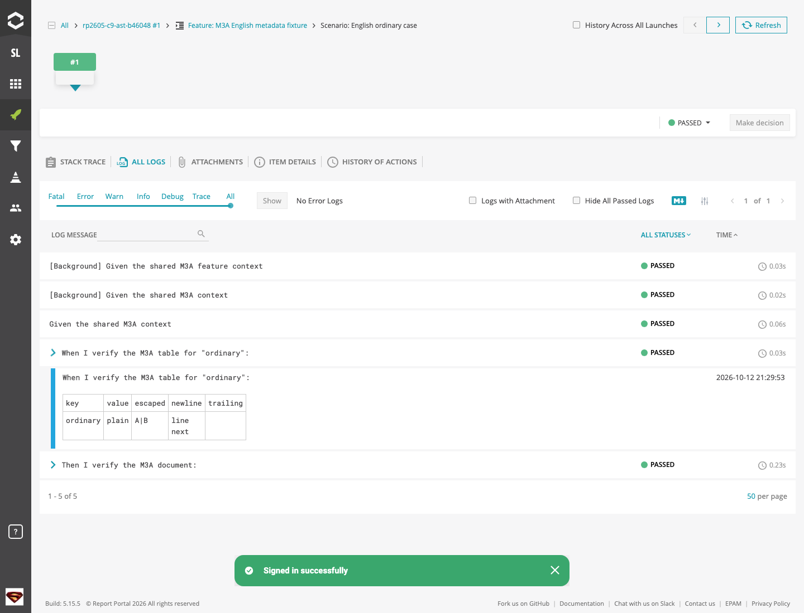

# reportportal-cucumber-ruby

Report Ruby Cucumber tests to ReportPortal, with readable Feature/Scenario/Step
structure, API request/response diagnostics, and screenshots owned by your tests.
Use the same `AppLog` calls for the terminal, native Cucumber HTML/messages, and
ReportPortal.

**New here?** Follow the five steps below. The
[complete getting-started guide](docs/getting-started.md) runs one Scenario without
a browser or a ReportPortal server before connecting your real project.

| What you need | Requirement |
| --- | --- |
| Ruby | `>= 3.1` |
| Cucumber | `>= 9, < 11` |
| Package | `reportportal-cucumber-ruby` **1.3.0**, from the GitHub release |
| ReportPortal | Your endpoint, project, and API key when enabling remote reporting |
| Browser tooling | Optional; belongs to your UI test project |

The SDK records tests and evidence. Your framework makes HTTP requests, performs
assertions, and owns browser/screenshot/video lifecycles. Logging an ERROR does
not fail a Scenario.

## 1. Install the released gem

Download the `.gem` asset from [v1.3.0](https://github.com/NickYin0125/CucumberReportportal/releases/tag/v1.3.0).
RubyGems.org publication is separate; use the release archive and an exact version
pin rather than assuming a registry install selects this release.

From **your automation project root**:

```sh
mkdir -p vendor/cache
curl -fL -o vendor/cache/reportportal-cucumber-ruby-1.3.0.gem \
  https://github.com/NickYin0125/CucumberReportportal/releases/download/v1.3.0/reportportal-cucumber-ruby-1.3.0.gem
gem install ./vendor/cache/reportportal-cucumber-ruby-1.3.0.gem --no-document
```

Add these entries to that project's `Gemfile`, then run `bundle install` from the
same directory:

```ruby
source "https://rubygems.org"
gem "cucumber", ">= 9", "< 11"
gem "reportportal-cucumber-ruby", "= 1.3.0"
```

Verify, still from **your project root**:

```sh
bundle exec ruby -e 'require "reportportal_cucumber"; puts ReportportalCucumber::VERSION'
```

Expected output: `1.3.0`. Installation may download dependencies; offline setup
requires all of them to be cached. See [installation details](docs/getting-started.md#1-install-the-release).

## 2. Run one minimal Scenario

[Copy the three files in the quick start](docs/getting-started.md#2-run-one-scenario-locally):
a Feature, `features/support/env.rb`, and a step-definition file. They perform
simple arithmetic and publish one structured diagnostic.

From **the quick-start project root**, after creating those files:

```sh
mkdir -p artifacts
RP_ENABLED=false bundle exec cucumber --no-profile --publish-quiet \
  --format progress \
  --format html --out artifacts/cucumber.html \
  --format message --out artifacts/messages.ndjson \
  --format ReportPortal::Cucumber::Formatter --out artifacts/reportportal.out
```

Expected: **1 Scenario / 2 steps passed**, exit `0`, and a `Sum result` diagnostic
inside the Then step in native HTML/messages. No Node, browser, or RP service is
needed. `reportportal.out` is a separate formatter destination and may be absent;
it is not an RP report or delivery receipt.

## 3. Connect an existing Cucumber project

Add to **your project's `features/support/env.rb`**:

```ruby
require "reportportal_cucumber"
World(ReportportalCucumber::Cucumber::World)

Around do |_scenario, run|
  AppLog.with_logger(Automation::CucumberLogger.new(world: self)) { run.call }
end
```

Bind once per Scenario; use `AppLog` from your steps, clients, and page objects.
Inject `RP_ENDPOINT`, `RP_PROJECT`, and `RP_API_KEY` through your normal secret
management, then run the same formatter command with `RP_ENABLED=true`.

Expected in RP: **Launch → Feature → Scenario → Step/Hook → logs and attachments**.
Each Scenario/Examples row counts as one test; its Steps and Hooks carry evidence.
The wire Scenario type is `STEP` with `hasStats=true`, rather than `TEST`.

See the [file-by-file integration recipe](docs/getting-started.md#3-connect-reportportal-and-integrate-an-existing-project)
for configuration, Cucumber profiles, and the first-report checklist.

## 4. Add API and UI evidence as needed

Start with [API, UI, and logger best practices](docs/best-practices.md). For a
runnable HTTP + Chromium project, use the
[current SDK example](examples/current_sdk/README.md) after the minimal Scenario.

| Need | Recommended call | Where it appears |
| --- | --- | --- |
| Local debugging | `AppLog.debug("message")` | Terminal |
| Business checkpoint / small JSON | `AppLog.info("message", report: true, json: payload)` | Terminal summary, native reports, RP |
| Observed HTTP exchange | `AppLog.http(...)` | All three tracks by default; performs no request |
| Expected/actual diagnostic | `AppLog.assertion(...)` | All three tracks by default; performs no assertion |
| Screenshot in native reports and RP | `AppLog.error("failure", report: true, file: path)` | All three tracks |
| RP-only artifact or manual group | `rp_attach(...)` / `rp_step("name") { ... }` | RP |
| Explicit RP failure ownership | `rp_capture_target` + `rp_evidence(...)` | The captured, still-open Step/Hook |

The report tracks require a bound World. Ordinary level methods are
terminal-only unless `report: true` (or legacy `attach: true`) is supplied.
Use one route per artifact to avoid submitting it twice. Publish Step evidence
before that Step closes; an After-hook screenshot belongs to the After Hook.
Keep file-backed evidence until reporting finalization settles.

Example of Step logs and a Gherkin table rendered in ReportPortal:



This existing screenshot comes from the [2026-10-12 compatibility run](https://github.com/NickYin0125/CucumberReportportal/blob/main/docs/reviews/2026-10-12-reportportal-26.0.5-compatibility.md)
on ReportPortal 26.0.5; it illustrates the layout, not a new validation of your
server or the quick-start Scenario.

## 5. Configure CI

[CI guide](docs/ci.md): pin dependencies, preserve the Cucumber exit status,
retain native evidence on failure, and decide whether reporting completeness is
required. Start with **one Launch per job**. For a shared parallel Launch, CI
creates it, injects its `RP_LAUNCH_UUID` into every worker, waits for every worker's
outcome and receipt, and completes it. Workers do not start or finish that Launch.

## Choose the next guide

| Topic | Guide |
| --- | --- |
| Complete minimal project, existing-project integration, first-report troubleshooting | [Getting started](docs/getting-started.md) |
| HTTP clients, Playwright, screenshots, logger levels/routing, safe assertions | [Best practices](docs/best-practices.md) |
| Job setup, artifacts, reporting gates, shared Launch ownership | [CI](docs/ci.md) |
| YAML keys, environment variables, defaults, units, profiles | [Configuration reference](docs/configuration.md) |
| Receipts, bounded queues, durable spool/replay, identities, attributes, links, video | [Advanced reporting](docs/advanced-reporting.md) |
| Current examples versus source QA and historical fixtures | [Examples index](examples/README.md) |
| Deploying the separate ReportPortal stack | [Helm operator guide](helm/reportportal-rich-experience/README.md) |
| Release changes | [Changelog](CHANGELOG.md) |
| Design contracts and dated verification | [Historical evidence index](docs/design/README.md) |

## Developing the SDK

From **an SDK source checkout**, with Ruby/Bundler installed:

```sh
bundle install
RUBYOPT=-rbundler/setup bundle exec rspec -Ilib -Ispec spec
bundle exec cucumber
```

Expected: RSpec and the default Cucumber suite complete successfully for a healthy
checkout. These are developer checks; consumers do not need the root development
bundle. Browser/live RP/duration checks are separate opt-ins in the
[examples index](examples/README.md).

The gem uses Cucumber, `cucumber-cucumber-expressions` (`>=17,<19`), `mime-types`,
and `aws-sdk-s3` for optional S3 video delivery. Cucumber 11 is unsupported.
Declared Ruby `>=3.1` compatibility is not a claim that every Ruby version was
tested. The historical [v1.3.0 release acceptance](https://github.com/NickYin0125/CucumberReportportal/blob/main/docs/reviews/2026-10-13-v1.3.0-release-acceptance.md)
records the environment and checks for that release.

## License

MIT
